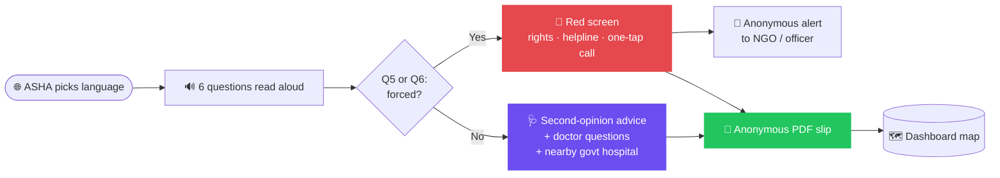

<div align="center">

#  Zaroori❓

### *Ask once more before a big decision.*

`🟣 Landing page live` &nbsp; `🌐 हिन्दी · ಕನ್ನಡ · English` &nbsp; `🔒 100% anonymous` &nbsp;

**A multilingual, audio-first tool that helps an ASHA didi sit with a village woman advised to remove her womb, and gently nudge her to pause, ask, and get a second opinion.**

</div>

---

##  Why this exists

> In some villages, young women were pushed into hysterectomy with **no clear medical need**.
> Many cannot read. Nobody told them they could get a **second opinion**. Some were pressured by **work contractors**.

Zaroori? does **not** say *"don't do surgery."*
It says one thing, and says it kindly:

<div align="center">

### ❝ Ask once more before a big decision. ❞

</div>

---

##  What it does

<table>
<tr>
<td width="50%" valign="top">

### 🗣️ Asks aloud
6 simple questions, read out in her own language. She answers with big icon buttons. **No reading needed.**

</td>
<td width="50%" valign="top">

### 🩺 Nudges a second opinion
Doctor questions to ask, plus the **nearest government hospital**.

</td>
</tr>
<tr>
<td valign="top">

### 📄 Gives proof
An **anonymous PDF slip** she can carry. No name on it.

</td>
<td valign="top">

### 🚨 Escalates coercion
Screen turns **red**, shows her rights and a helpline, and the case reaches an NGO or officer **the same day**.

</td>
</tr>
<tr>
<td colspan="2" valign="top">

### 🗺️ Spots patterns
An anonymous district dashboard flags hospitals with unusual surgery-advice counts, **for human review, never as an accusation.**

</td>
</tr>
</table>

---

##  Who uses it

| | Role | What they do |
|---|---|---|
| 👩 | **Woman** *(primary)* | Low literacy, low-end phone, speaks Hindi or Kannada |
| 🤝 | **ASHA didi** *(operator)* | Sits with her, runs the app, picks the language |
| 🛟 | **NGO / officer** *(responder)* | Receives coercion cases the same day |
| 📊 | **Health official** *(viewer)* | Watches the district dashboard |

---

##  How it flows



<details>
<summary><b>❓ The 6 questions (draft)</b></summary>

1. Your age band (under 25, 25 to 35, over 35)
2. Has a doctor advised removing the womb?
3. What reason did the doctor give?
4. Has another doctor confirmed it?
5. Did anyone else (family, contractor, employer) push you to do it?
6. Do you feel free to say no?

**Question 5 or 6 answered "forced" triggers the red screen.**

</details>

---

##  Principles we will not break

| # | Principle |
|---|---|
| 1 | 🚫 **We never diagnose.** |
| 2 | 🚫 **We never say "you don't need surgery."** Every generated line is checked against a blocklist. |
| 3 | 🔒 **No names, phone numbers or Aadhaar are ever stored.** |
| 4 | ⚖️ **Coercion detection is rule-based**, not a black-box model. |
| 5 | 🔎 **Hospital flags are a prompt to check, not an accusation.** Reviewed first, never shown publicly. |
| 6 | ✍️ **AI drafts, a person verifies.** All translations are human-reviewed. |

---

## 🧱 Tech plan

| Layer | Stack |
|---|---|
| 🎨 Frontend | React + Vite + Tailwind, installable **PWA** with offline queue |
| 🌌 Landing page | Three.js 3D hero, glass UI, language switcher ✅ *(in this repo)* |
| ⚙️ Backend | FastAPI (or Node/Express) + PostgreSQL on Render |
| 🔊 Voice | Text-to-speech in Hindi, Kannada, English |
| 🗺️ Map | Leaflet or MapLibre + district GeoJSON + NFHS indicators |

<details>
<summary><b>🔌 Planned API endpoints</b></summary>

```http
POST /sessions                  start an anonymous session
POST /sessions/{id}/answers     save answers
GET  /sessions/{id}/result      second-opinion message, doctor questions, hospital
POST /sessions/{id}/slip        generate the anonymous PDF
POST /alerts                    create a coercion case, notify NGO / officer
GET  /dashboard/cases           anonymous cases by district
GET  /dashboard/flags           hospitals with 3+ advised surgeries
GET  /hospitals?district=       nearest government hospitals
```

</details>

---


---

##  Run the landing page

No build step needed.

```bash
git clone https://github.com/sharanyashetty013-droid/Zaroori_-Two-Pointers-.git
cd Zaroori_-Two-Pointers-
python3 -m http.server 8000
# open http://localhost:8000
```

###  Connect the "Open Console" button to the frontend

Edit **`config.js`** and set your frontend address:

```js
window.ZAROORI_CONFIG = {
  CONSOLE_URL: "http://localhost:3000",   // later: your deployed URL
  OPEN_IN_NEW_TAB: false
};
```

---

## 📁 Repo structure

```
├── index.html          landing page (HTML + CSS + JS)
├── config.js           the one file to edit to link the frontend console
├── docs/
│   └── Zaroori_PRD.pdf full product requirements
└── README.md
```

---

##  Privacy and safety

- 🕶️ Anonymous by design: only session ID, language, age band, district, advising hospital, answers, coercion flag and timestamp
- ✅ Consent shown before any case is sent
- 📍 Alerts carry the **district only**, never identity
- ⚖️ Red-screen content and helpline numbers verified by a legal or NGO partner before launch
- 🏷️ Demo data is always labelled as demo

---

<div align="center">

### Built with ❤️ for **recHERsion 2026**
Frontend · Backend · AI & Data

*Zaroori? Because a big decision deserves one more question.*

</div>
