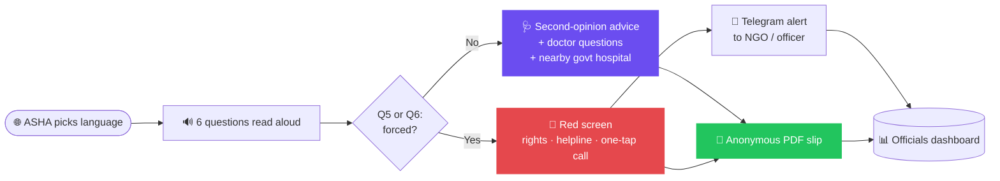

<div align="center">

# Zaroori❓

### *Ask once more before a big decision.*

`🟢 Live on Vercel + Render` &nbsp; `🌐 हिन्दी · ಕನ್ನಡ · English` &nbsp; `🔒 100% anonymous` &nbsp; `📨 Telegram alerts`

**A multilingual, audio-first tool that helps an ASHA didi sit with a village woman advised to remove her womb, and gently nudge her to pause, ask, and get a second opinion.**

</div>

---

## 🚀 Try it

- **Live app:** https://zaroori-virid.vercel.app
- **ASHA login:** `/login` · **Officials dashboard:** `/officials`
- Judge test accounts are on the login pages. No real ASHA worker or patient data is used anywhere.
- The backend is on a free tier, so the first load can take about a minute to wake up.

---

## Why this exists

> In some villages, young women were pushed into hysterectomy with **no clear medical need**.
> Many cannot read. Nobody told them they could get a **second opinion**. Some were pressured by **work contractors**.

Zaroori does **not** say *"don't do surgery."*
It says one thing, and says it kindly:

<div align="center">

### ❝ Ask once more before a big decision. ❞

</div>

---

## What it does

<table>
<tr>
<td width="50%" valign="top">

### 🗣️ Asks aloud
6 simple questions, read out in her own language. She answers with big icon buttons. **No reading needed.**

</td>
<td width="50%" valign="top">

### 🩺 Nudges a second opinion
Doctor questions to ask, plus the **nearest government hospitals**.

</td>
</tr>
<tr>
<td valign="top">

### 📄 Gives proof
An **anonymous PDF slip** with a slip code. No name on it.

</td>
<td valign="top">

### 🚨 Escalates coercion
Screen turns **red** and shows her rights and a helpline. When the ASHA taps share, an **anonymous alert lands on Telegram within seconds**, with the district and slip code only. Failed deliveries are **retried automatically**.

</td>
</tr>
<tr>
<td colspan="2" valign="top">

### 🗺️ Spots patterns
A district dashboard flags hospitals with unusual surgery-advice counts, **for human review, never as an accusation.**

</td>
</tr>
</table>

---

## Who uses it

| | Role | What they do |
|---|---|---|
| 👩 | **Woman** *(primary)* | Low literacy, low-end phone, speaks Hindi or Kannada |
| 🤝 | **ASHA didi** *(operator)* | Sits with her, runs the app, picks the language |
| 🛟 | **NGO / officer** *(responder)* | Receives coercion alerts on Telegram the same day |
| 📊 | **Health official** *(reviewer)* | Watches the dashboard, reviews flags and alerts |

---

## How it flows



<details>
<summary><b>❓ The 6 questions</b></summary>

1. Your age band (under 25, 25 to 35, over 35)
2. Has a doctor advised removing the womb?
3. What reason did the doctor give?
4. Has another doctor confirmed it?
5. Did anyone else (family, contractor, employer) push you to do it?
6. Do you feel free to say no?

**Question 5 or 6 answered "forced" triggers the red screen.**

</details>

---

## 📨 Telegram alerts

When a case is shared, the backend sends a message to a Telegram chat for the NGO or health team.

- Contains only the **district, ASHA code, and slip code**. Never the woman's name or phone number.
- The same slip code is on the PDF and in the officials dashboard, so a responder can match them.
- A background loop retries failed deliveries until they go through.
- The bot token lives only in a server environment variable (`ALERT_WEBHOOK_URL`), never in the repo.

---

## Principles we will not break

| # | Principle |
|---|---|
| 1 | **We never diagnose.** |
| 2 | **We never say "you don't need surgery."** Every generated line is checked against a blocklist. |
| 3 | **No names, phone numbers or Aadhaar are ever stored.** |
| 4 | **Coercion detection is rule-based**, not a black-box model. |
| 5 | **Hospital flags are a prompt to check, not an accusation.** A flag needs 3+ advised-surgery cases from at least 2 different ASHAs, and a reviewer checks it first. |
| 6 | **AI drafts, a person verifies.** All translations are human-reviewed. |

---

## 🧱 Tech stack

| Layer | Stack |
|---|---|
| 🎨 Frontend | HTML/JS app + Three.js landing page, hosted on **Vercel** |
| ⚙️ Backend | **FastAPI** + SQLAlchemy, hosted on **Render** |
| 🔊 Voice | Backend TTS for Hindi, Kannada, English |
| 📨 Alerts | **Telegram bot** webhook with retry loop |
| 🔐 Access | Separate keys for ASHA, reviewer, and admin roles |
| 📊 Analytics | Fisher exact test + Benjamini-Hochberg correction, NFHS district context |

<details>
<summary><b>🔌 API endpoints</b></summary>

```http
POST /sessions                          start an anonymous session (ASHA key)
POST /sessions/{id}/answers             save answers
GET  /sessions/{id}/result?lang=        headline, doctor questions, govt hospitals, red alert block
POST /sessions/{id}/slip                generate the anonymous PDF
POST /alerts                            create a coercion case, notify via Telegram
GET  /hospitals?district=               hospitals in a district
GET  /dashboard/flags                   hospitals with 3+ cases and review status (reviewer)
POST /dashboard/flags/{hospital_id}/review   open / reviewing / dismissed / escalated (reviewer)
GET  /dashboard/anomalies               statistical comparison across hospitals (reviewer)
POST /admin/ashas                       create an ASHA account (admin)
POST /admin/hospitals                   load the hospital list (admin)
```

</details>

---

## Run it locally

```bash
git clone https://github.com/sharanyashetty013-droid/Zaroori_-Two-Pointers-.git
cd Zaroori_-Two-Pointers-/backend
python -m venv venv
source venv/Scripts/activate      # Windows Git Bash; use venv/bin/activate on Mac/Linux
pip install -r requirements.txt
uvicorn app.main:app --reload
```

Set `ADMIN_API_KEY`, `REVIEWER_API_KEY` and `ALERT_WEBHOOK_URL` as environment variables (or in a local `.env`, which is never committed). Optional demo data: `python -m app.seed`.

---

## 📁 Repo structure

```
├── backend/     FastAPI app, models, alerts, dashboard
├── frontend/    ASHA app and officials dashboard
├── index.html   landing page
├── config.js    console link
├── docs/        PRD
└── README.md
```

---

## Privacy and safety

- Anonymous by design: only session ID, language, age band, district, advising hospital, answers, coercion flag and timestamp
- Consent shown before any case is sent
- Alerts carry the **district only**, never identity
- Red-screen content and helpline numbers to be verified by a legal or NGO partner before real-world launch
- This is a working prototype. Judge accounts use test data only, because real ASHA data needs official permission. Next step: a pilot with the Udupi health department.

---

<div align="center">

### Built with ❤️ for **recHERsion 2026**

*Zaroori? Because a big decision deserves one more question.*

</div>
